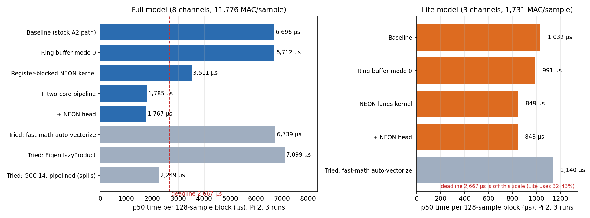
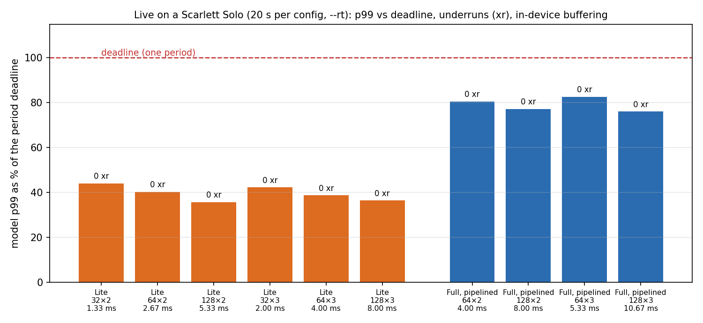
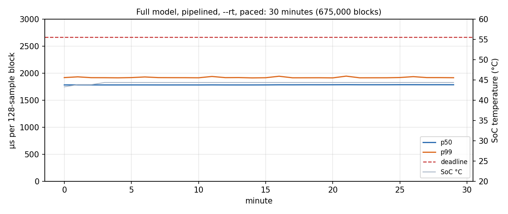

# pi-neural-amp: a neural guitar amp on a Raspberry Pi 2, profiled like a product

> **Draft (Claude).** Per [CLAUDE.md](CLAUDE.md), Christine rewrites the analysis sections
> ("What I changed and why", "What I learned") in her own words. Every number below comes from a CSV in
> [`results-pi/`](results-pi/), produced by a script in [`scripts/`](scripts/) or by
> [`bench`](src/bench.cpp) / [`live`](src/live.cpp). The full record, iteration by iteration, is
> [docs/experiment-report.md](docs/experiment-report.md).

A [Neural Amp Modeler](https://github.com/sdatkinson/NeuralAmpModelerCore) (NAM) A2 model of a 1965
Fender Super Reverb runs in real time on a **Raspberry Pi 2**: 4× Cortex-A7 @ 900 MHz, 1 GB RAM,
32-bit, released 2015. Guitar in, amp out, through a USB audio interface. The model is a 23-layer
dilated-convolution WaveNet. Its full-size version needs **11,776 multiply-adds per audio sample**,
48,000 times a second, and at the start it ran **2.5× too slow** to keep up.

## Results

| KPI | Before | After | Source |
|---|---|---|---|
| **Full model, time per 128-sample block** (p50 / p99) | 6,696 / 6,925 µs, **251%** of the real-time budget | **1,767 / 1,910 µs, 66%** (**3.79× faster**) | `kpi_by_block.csv` (tags `baseline`, `head`) |
| **Lite model, time per block** (p50 / p99) | 1,032 / 1,092 µs | **843 / 917 µs** | `kpi_by_block.csv` |
| **Smallest live buffer, Full** (Scarlett Solo, `--rt`) | can't run live at any size | **64 × 2 periods + 64-sample pipeline = 4.0 ms in-device buffering**; **1 underrun in 450,000 periods (10 min)** | `live_summary.csv` (`lsw_full_pipe`, `live10_full_pipe_64x2`) |
| **Smallest live buffer, Lite** | — | **32 × 2 = 1.33 ms**, 0 underruns | `live_summary.csv` (`lsw_lite`) |
| **30-minute sustained, Full** (paced, `--rt`) | — | p99 1,922 µs every minute; 7 overruns in 675,000 blocks (each ≤ 35 µs over); 44 °C peak, never throttled | `summary_sustained_full_pipe3.csv`, `sustained_per_minute_full_pipe3.csv` |
| **Memory** (live, whole process) | — | Lite **5.6 MB**, Full pipelined **5.8 MB** PSS (5,582 / 5,842 kB) | `live_summary.csv` (`first_live`, `memfix_build-nhead2`) |
| **Output accuracy** | — | Identical to the reference: bit-exact, or −130 dB (summation order) | `null_tests.csv`, `x_null_tests.csv` |

"In-device buffering" is the delay inside the Pi: ALSA periods plus the pipeline block. **Round-trip
latency (guitar to ears) is not measured yet:** the interface's converters and USB add to it, and
measuring it needs a loopback cable.

## Setup

| | |
|---|---|
| Board | Raspberry Pi 2 Model B, Raspbian 13 (trixie) 32-bit, kernel 6.18 (stock, `PREEMPT_VOLUNTARY`), `performance` governor |
| Audio | Focusrite Scarlett Solo 3rd gen over USB 2.0 (480M), 48 kHz, S32_LE; guitar: Squier Stratocaster into the instrument input |
| Model | [`a2_fender_super_reverb.nam`](models/README.md) (A2, from TONE3000): **Lite** 3 channels, 1,731 MAC/sample; **Full** 8 channels, 11,776 MAC/sample |
| Build | clang 16, cross-compiled on a Mac against a Debian Bookworm armhf sysroot ([`scripts/cross_build.sh`](scripts/cross_build.sh)); NAM Core v0.6.0 + this repo's [patches](patches/) applied to a build-dir copy |
| Offline harness | [`bench`](src/bench.cpp): times every `process()` call against the deadline (back-to-back or paced like an audio callback); [`sweep.sh`](scripts/sweep.sh), [`remote_sweep.sh`](scripts/remote_sweep.sh), [`kpis.py`](scripts/kpis.py) |
| Live client | [`live`](src/live.cpp): full-duplex ALSA, `--rt` (SCHED_FIFO 80, pinned core, `mlockall`), `--pipeline`, `--mmap`, `--gate`, `--record` |

Reproduce: [RUNBOOK.md](RUNBOOK.md). Best build: `-DBENCH_A2_RING_MODE=0` + patches
`a2_full_neon_tile`, `a2_lite_neon_lanes`, `a2_pipeline`, `a2_head_neon`, `a2_pipeline_stack`.

## What I changed and why *(draft, for Christine to rewrite)*

1. **Measured before changing anything.** `perf` showed neither model was memory-bound (> 98.9% L1 hits).
   Full spent 59% of its time in Eigen's matrix-multiply kernel and **22% just repacking data** for 179
   small 8×8 multiplies per block. Lite ran entirely scalar. (`results-pi/perf/perf_base/`)
2. **Measured the hardware's limit.** A microbenchmark ([`src/neon_peak.cpp`](src/neon_peak.cpp)) showed
   that on the Cortex-A7 **every floating-point form, scalar or NEON, peaks at ~1 float operation per
   cycle**: a 4-lane NEON op takes ~4 cycles. Vectorizing only pays by removing *non-math* instructions.
   (`neon_peak.csv`)
3. **That explained two failures.** Letting the compiler auto-vectorize Lite (`-ffast-math`) cut its
   instructions 55% but made it **10% slower** (de-interleaving loads, register spills, IPC 0.89 → 0.36).
   Replacing Eigen's GEMM with `lazyProduct` removed the packing but made Full **6% slower** (weights
   reloaded per column). (`kpi_by_block.csv` tags `a2fm`, `lazy`)
4. **Wrote register-blocked NEON kernels** that keep an 8-output × 4-frame tile of accumulators in
   registers across all taps, and fuse bias, activation, skip-sum and the 1×1 residual. **Full 1.91×
   faster, Lite 1.17×**, output identical (−132.8 dB on the Pi / bit-exact). (`neon`)
5. **Used a second core.** A lock-free two-stage pipeline (layers 0–12 | 13–22 + head, two atomics,
   spin-wait) gave **1.97×**, near-perfect scaling, for one extra block of delay. The split point was tuned
   by measurement (layer 13 beats 12 and 14 by ~140 µs). (`pipe_full`, `summary_pipe_split.csv`)
6. **Smaller wins:** ring-buffer mode 0 (Lite −4%, max −18%, bit-identical) and the output head as one
   NEON dot product (−1%). (`ring0`, `head`)
7. **Things that didn't help, kept as results:** a global VMLA compiler flag (no change), GCC 14 (Lite
   −6% but Full +26% from register spills), ALSA mmap (no benefit; breaks pipelined Full at 2 periods),
   int16 fixed point (2× faster arithmetic but −65 to −75 dB, fails the accuracy bar), the GPU (no
   compute path under the KMS driver). ([docs/beyond-fpu.md](docs/beyond-fpu.md))

## What I learned about measuring *(draft)*

- **The monitoring tools caused the worst tail latency.** A memory sampler that forked every 0.2 s raised
  Lite's p99 by **27%** (0.254 s periodic spikes; `spikes.csv`, tag `ctl_sampler`). A thermal logger that
  called `vcgencmd` stalled the audio cores for up to **7 ms**; replacing it with a fork-free logger
  took a 30-minute run from **66 overruns to 7** (`summary_sustained_full_pipe*.csv`).
- **`--rt` fixes wake-up latency, not compute.** SCHED_FIFO + pinning cut wake-up p99 ~4× (73–80 →
  16–24 µs; `kpi_by_block.csv` tags `lite_paced`, `lite_paced_rt`) and left compute time unchanged.
- **Hum was the guitar, not the Pi.** One change at a time showed −126 dBFS with the guitar volume at 0
  and up to −69 dBFS with single-coil pickups live (`hum_check.csv`). A noise gate before the model
  cut the amp's noise in silence by **30 dB** (−58 → −88 dBFS) with no added latency (`gate_compare.csv`;
  the gated take's own input was also 5.4 dB quieter).

## Resume line (measured numbers only)

**Neural Guitar Amp on Raspberry Pi 2 | C++, ARM NEON, Linux real-time, perf**
- Built a real-time neural guitar amp on a Raspberry Pi 2 (900 MHz ARM, C++) that went from unable to keep
  up at any buffer size to playing live with 4 ms of in-device buffer latency (1.3 ms for the lite model),
  using hand-written NEON kernels and a lock-free 2-core pipeline (3.8× faster inference, 5.8 MB);
  output verified identical by null test.

More variants and a fact-check table: [docs/resume-bullet.md](docs/resume-bullet.md).

## Open items

- **Round-trip latency** (needs an RCA → ¼" loopback cable; `scripts/latency_test.sh` is ready).
- **Core isolation** (`isolcpus`, IRQ affinity) and a **PREEMPT_RT** kernel for the last rare overruns.
- **Frame split** (`patches/a2_frame_split.patch`): same speed as the pipeline without its extra block,
  943 µs per block on 4 cores offline, bit-identical; not yet run live ([docs/low-latency-plan.md](docs/low-latency-plan.md)).
- **I2S converters** instead of USB: the only route to round trips under ~2 ms (estimate).
- Status of every optimization (adopted, rejected, pending, needs Christine): [docs/optimizations-summary.md](docs/optimizations-summary.md).

## Repo map

| Path | What |
|---|---|
| [src/](src/) | `bench`, `live`, microbenchmarks (`neon_peak`, `int_peak`, `sync_peak`, `kernel_peak`), shared `common.h` |
| [patches/](patches/) | NAM Core changes, applied to a build-dir copy (never the submodule) |
| [scripts/](scripts/) | build/deploy, sweeps, profiling, KPI tables, charts, null/hum/gate analysis |
| [results-pi/](results-pi/) | every CSV quoted here (large per-block traces, WAVs and perf data are not committed) |
| [docs/](docs/) | experiment report, roadmaps, low-latency plan, beyond-FPU research, live testing, resume bullets |
| [docs/state-of-the-union.md](docs/state-of-the-union.md) | how the audio runs right now: signal chain, threads/cores, recommended `live` commands and their measured numbers |
| [learning/](learning/) | study notes: real-time audio, WaveNet (with figures), ARM performance, guitars and hum, … |
