# 10: The A2 WaveNet, one sample at a time

[02-nam-and-wavenet.md](02-nam-and-wavenet.md) gives the overview: what NAM is, the layer list, and how
to count MACs. This file goes further. It follows one input sample through
`models/a2_fender_super_reverb.nam` to one output sample: every tensor shape, every weight, the code
that does each step, and what the network does on real guitar audio.

**Where the numbers come from.** Structural numbers (layer counts, dilations, weight counts, MACs) are
read from the `.nam` file. Every figure and every "observed" number is printed by
`scripts/make_wavenet_figures.py`. That script reuses the loader and the float64 forward pass from
`scripts/quant_sim.py`. I checked the forward pass against the C++ fast path (`build/bench --render`,
Mac build, unpatched `a2_fast.cpp`). On the first 10 s of `audio/di.wav`, the residual is **−130.2 dB
for Lite** and **−130.2 dB for Full** (both rerun for this doc with `--check-render`;
`results-pi/quant_sim.csv` already had −130.2 for Full). So the Python and the C++ compute the same function. Speedups come from
[../docs/experiment-report.md](../docs/experiment-report.md) and
[../docs/low-latency-plan.md](../docs/low-latency-plan.md). Anything I couldn't measure is labeled
**Interpretation**.

Regenerate everything with:

```
<venv>/bin/python scripts/make_wavenet_figures.py          # ~8 s; writes learning/img/wn*.png, prints the numbers
```

---

## 1. The job

An amp model is a **function from a stream of numbers to a stream of numbers**. At 48 kHz the guitar
arrives as 48,000 samples per second: floats in [−1, 1], one per **frame** (here one channel, so a frame
is one sample). The model has to emit one output sample for every input sample, with these rules:

- **Causal:** output y[t] may depend on inputs u[t], u[t−1], u[t−2], … but never on u[t+1]. A live
  amp can't see the future.
- **Finite memory:** in this model, y[t] depends on exactly the last **6,347** inputs,
  u[t−6346] … u[t]. That window is the **receptive field**. At 48 kHz it is 6,347 / 48,000 =
  **132.2 ms** (section 4).
- **Nonlinear:** doubling the input doesn't double the output. That's distortion and compression
  (section 8).

**Why a neural net instead of a circuit simulation (briefly).** A circuit simulator (SPICE-style, or a
hand-derived "white-box" model) solves the amp's differential equations. That's accurate, but it needs
the schematic and component values, and tubes and transformers are hard to model. A **black-box**
model learns the input→output map from recordings, so it needs only the amp and a microphone. Wright
et al. (2020, reading list) showed a WaveNet-style network can emulate guitar amplifiers this way in
real time. NAM is a productized version of that idea.

**Training (briefly; this file is about inference).** Play a fixed test signal through the real amp
and cab, record the result, and adjust the weights by gradient descent until the network's output
matches the recording sample by sample. This file's metadata says amalgamaudio made the capture with
TONE3000's trainer (`"trainer": "TONE3000"`, `"gear_type": "amp_cab"`, Fender Super Reverb 1965).
**Inference** means running the trained network with frozen weights. That's what the Pi does.

**The file.** `models/a2_fender_super_reverb.nam` is JSON. Its `architecture` is
`SlimmableContainer`, holding two `WaveNet` submodels:

| | Lite | Full |
|---|---|---|
| `channels` (C, the width) | 3 | 8 |
| `bottleneck` | 3 | 8 (= C, so every layer matrix is C × C) |
| weights in the file | 1,871 | 12,146 |
| `max_value` (slim selector) | 0.5 | 1 |

Both submodels share: 23 layers; `kernel_sizes` 6 ×14, 15, 15, 6 ×7; `dilations`
1, 3, 7, 17, 41, 101, 239, 1, 3, 7, 17, 41, 101, 239, 1, 13, 1, 3, 7, 17, 41, 101, 239; `LeakyReLU`
with `negative_slope` 0.01 on every layer; `gating_mode` "none"; `layer1x1` active; `head1x1`
inactive; no FiLM; `condition_size` 1; layer-array head `kernel_size` 16, `out_channels` 1,
`bias` true; `head_scale` 0.011273000426214248; sample rate 48,000.

`--slim V` picks the submodel: NAM's container (`NAM/container.cpp`) takes the first submodel whose
`max_value` is greater than V, so V < 0.5 → Lite, otherwise Full.

---

## 2. Shapes and data flow for one block

The code never processes a single sample. The audio callback hands it a **block** of N frames (N = 128
in most of the experiments), and every step runs on the whole block. Tensors are **channels × frames**,
stored **column-major** (one frame's C channel values are contiguous; see `a2_fast.cpp`'s header
comment).

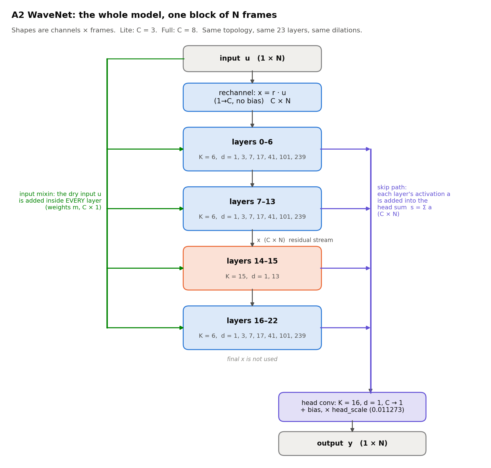

| Step | Operation | Output shape | Lite | Full |
|---|---|---|---|---|
| input | u, one block of audio | 1 × N | 1 × 128 | 1 × 128 |
| rechannel | x = r · u (r is C × 1, **no bias**) | C × N | 3 × 128 | 8 × 128 |
| each of 23 layers | x ← layer_i(x, u); s += a_i | C × N (x and s) | 3 × 128 | 8 × 128 |
| head sum | s = Σ over layers of a_i | C × N | 3 × 128 | 8 × 128 |
| head conv | K = 16, C → 1, + bias | 1 × N | 1 × 128 | 1 × 128 |
| scale | y = head_scale × that | 1 × N | 1 × 128 | 1 × 128 |

Three paths run through the stack (all drawn in the figure above):

- **Residual stream x** (blue, down the middle). Each layer reads x and writes a new x, the next
  layer's input. The last layer's x is computed but never used: only the head sum reaches the output.
- **Input mixin** (green, left). The *raw* input u is fed into every layer, not only the first. The
  WaveNet paper calls this *conditioning* (section 2.4). Here the "condition" is the dry guitar itself.
- **Skip path / head sum** (violet, right). Every layer's activation is added into one running sum s,
  and the output is computed from s. Shallow and deep layers both contribute to the output directly.

**The weight stream.** The `weights` array is flat. `_load_weights` in `a2_fast.cpp` (which mirrors the
generic `LayerArray::set_weights_`) reads it in this order:

| Piece | Count | Read order (generic loader) |
|---|---|---|
| rechannel r | C | for out channel |
| per layer: dilated conv W | K · C · C | for out i: for in j: for tap k |
| per layer: conv bias b | C | |
| per layer: mixin m | C | (no bias) |
| per layer: 1×1 L | C · C | for out i: for in j |
| per layer: 1×1 bias c | C | |
| head weights h | C · 16 | for in j: for tap k |
| head bias | 1 | |
| **head_scale** | 1 | the **last float in the stream** |

Counting gives C + Σ_layers (K·C² + 3C + C²) + 16C + 2 = **1,871** for C = 3 and **12,146** for C = 8,
exactly the file's lengths (the script asserts this). Note the last row: the trailing weight is
0.011273000174…, the JSON's `head_scale` rounded to float32. Both C++ paths use the trailing weight,
not the JSON field (`model.cpp` line ~673: `_head_scale = *(it++)`).

---

## 3. One layer in detail

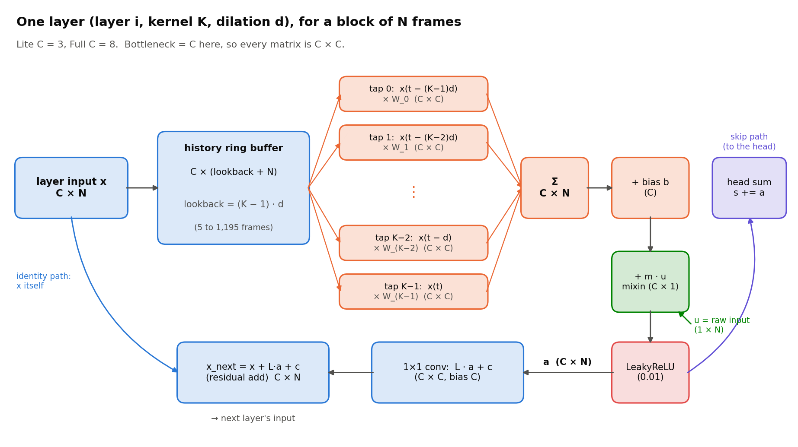

Notation for layer i: kernel size K, dilation d, input x (C × N), raw input u (1 × N). The layer's
weights are K tap matrices W₀ … W_{K−1} (each C × C), conv bias b (C), mixin weights m (C), 1×1 matrix
L (C × C), and 1×1 bias c (C).

**Step 1: dilated causal convolution.** A **convolution** slides a small weighted window along time. A
**causal** convolution's window covers only the present and the past. **Dilated** means the window's
taps are spaced d samples apart instead of 1. Tap k reads the input from (K−1−k)·d samples ago, so
tap K−1 is "now" and tap 0 is the oldest. Each tap is a C × C matrix that mixes all input channels
into all output channels:

```
conv_i(t) = Σ_{k=0}^{K−1} Σ_{j=0}^{C−1}  W_k[i, j] · x_j(t − (K−1−k)·d)
```

**Step 2: bias and input mixin.** Add a constant per channel, plus a per-channel multiple of the raw
input sample at time t:

```
z_i(t) = b_i + conv_i(t) + m_i · u(t)
```

**Step 3: LeakyReLU**, the only nonlinearity in the network:

```
a_i(t) = z_i(t)          if z_i(t) ≥ 0
       = 0.01 · z_i(t)   otherwise
```

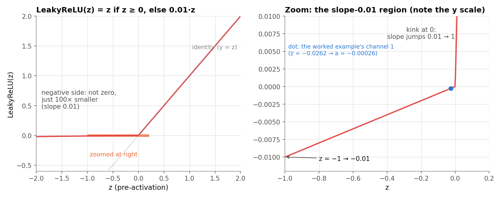

A **ReLU** clips negatives to 0. A **Leaky** ReLU lets 1% through, so a channel that goes negative
still passes a little signal and gradient. All the distortion in the model comes from these kinks at
zero, 23 layers × C channels of them, at different bias points (Interpretation: that's how the network
builds smooth, level-dependent clipping out of piecewise-linear parts).

**Step 4: skip path.** Add the activation into the head sum: `s_i(t) += a_i(t)`.

**Step 5: 1×1 conv and residual add.** A **1×1 convolution** is a convolution with one tap, i.e. a
C × C matrix applied to each frame independently. Its output is *added* to the layer's input
(a **residual connection**), so a layer only has to learn a correction to x:

```
x_next_i(t) = x_i(t) + c_i + Σ_j L[i, j] · a_j(t)
```

**Where this is in the code.** `_layer_forward_k<K>` in `a2_fast.cpp`. For Lite (`Channels == 3`),
tap 0 seeds the accumulator z with `conv_b`, taps 1…K−2 accumulate into z, and the final tap is fused
with "mixin → LeakyReLU → head_sum += → layer1x1 residual" in one frame loop, on scalars that stay in
registers. For Full the unpatched code runs one Eigen 8×8 × 8×N matrix multiply per tap, then block
operations for the rest. The math is the same.

### Worked example (Lite, layer 0, one real sample)

Layer 0 has K = 6, d = 1, so its taps are the last six samples. Its input is the rechannel output
x = r · u with r = [−0.3222, −1.0884, −0.9545]. The script picks the first frame in the 19.25–20.25 s
segment where the input is moderate (0.05 < |u| < 0.2) and one channel goes negative. That is sample
**942,601** of `di.wav` (19.638 s). All values are rounded to 4 digits; the script prints them.

Raw input u(t−5 … t) = −0.3842, −0.3309, −0.2774, −0.2242, −0.1718, **−0.1211**.

| Tap k | Lag (K−1−k)·d | x(t − lag) = r · u | W_k · x (3 values) |
|---|---|---|---|
| 0 | 5 | [0.1238, 0.4181, 0.3667] | [0.0540, −0.3685, −0.2868] |
| 1 | 4 | [0.1066, 0.3601, 0.3159] | [0.2222, −0.1980, −0.0117] |
| 2 | 3 | [0.0894, 0.3019, 0.2648] | [0.2012, −0.1397, −0.0087] |
| 3 | 2 | [0.0722, 0.2440, 0.2140] | [−0.4874, 0.2763, 0.2818] |
| 4 | 1 | [0.0553, 0.1869, 0.1639] | [−0.0783, 0.1689, 0.0259] |
| 5 | 0 | [0.0390, 0.1318, 0.1156] | [0.0208, 0.0941, 0.0129] |
| **Σ taps** | | | **[−0.0675, −0.1669, 0.0135]** |

To check one entry by hand, tap 5's first output channel is W₅ row 0 · x(t):
0.0374·0.0390 + 0.0153·0.1318 + 0.1496·0.1156 = 0.0015 + 0.0020 + 0.0173 = 0.0208.

Then:

| | ch 0 | ch 1 | ch 2 |
|---|---|---|---|
| Σ taps | −0.0675 | −0.1669 | 0.0135 |
| + bias b | 0.2658 | 0.1757 | 0.1509 |
| + mixin m · u(t), m = [0.2760, 0.2892, 0.1504] | −0.0334 | −0.0350 | −0.0182 |
| **z** | **0.1648** | **−0.0262** | **0.1462** |
| **a = LeakyReLU(z)** | 0.16478 | **−0.00026** (×0.01) | 0.14615 |
| L · a + c (residual update) | 0.1267 | −0.2301 | −0.2175 |
| **x_next = x(t) + that** | **0.1657** | **−0.0982** | **−0.1019** |

Channel 1 went negative, so LeakyReLU passed only 1% of it: it adds −0.00026 to the head sum and
almost nothing to the 1×1. The script recomputes a and x_next from the full forward pass and gets the
same numbers. After all 23 layers and the head, this frame's output is y = 0.2763.

That's the whole layer: 6 × 9 = 54 conv MACs, 3 mixin MACs, 9 1×1 MACs, and a compare per channel.
The other 22 layers repeat it with their own weights, K and d.

---

## 4. Dilation and the receptive field

**What one layer sees.** A layer's output at t depends on its input at t, t−d, …, t−(K−1)·d. That
reach, (K−1)·d samples, is the layer's **look-back**. With K = 6 and d = 239 it's 1,195 samples from
only 6 taps.

**Stacking.** Layer i+1 reads layer i's outputs, and each of those reaches back further, so the
look-backs **add up**. Panel (a) below is one layer; panel (b) is the dependency tree of one output
after three layers (d = 1, 3, 7): 1 + 5 + 15 + 35 = 56 input samples, and every one of them is
reached.

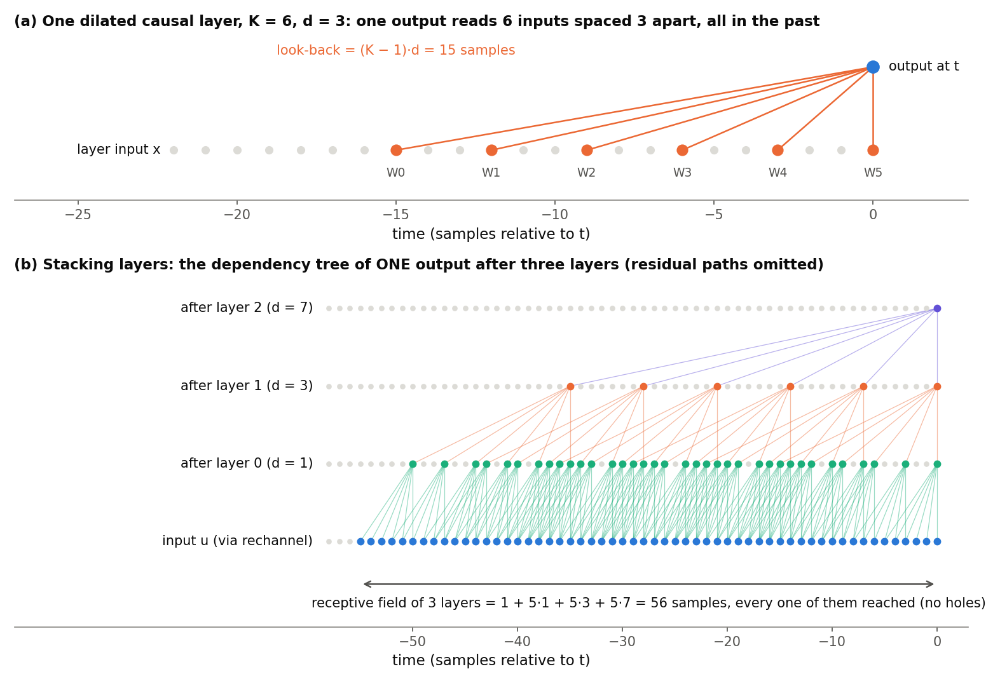

**Why 1, 3, 7, 17, 41, 101, 239?** Each dilation is about **2.4×** the previous one (3, 2.33, 2.43,
2.41, 2.46, 2.37). With K = 6, each layer's look-back is 5d, so layer n+1's tap spacing (d_{n+1}) is
always smaller than the span the previous layers already cover. That leaves **no holes**: the script
enumerates every lag reachable through one 7-layer group, Σ j_n·d_n with j_n ∈ 0..5, and finds all
2,046 lags 0…2,045 (contiguous). The original WaveNet doubles the dilation (1, 2, 4, …) with K = 2.
A2 uses wider kernels and a ×~2.4 ratio, which reaches 2,045 samples in 7 layers.
**Interpretation:** 3, 7, 17, 41, 101 and 239 are all prime, so taps from different layers rarely land
on the same lags. The file doesn't record why these values were chosen.

The ladder repeats three times (layers 0–6, 7–13, 16–22). Between the second and third repeat sit two
**K = 15** layers with d = 1 and d = 13 (look-backs 14 and 182).
**Interpretation:** they add a dense, fine-grained window in the middle of the stack.

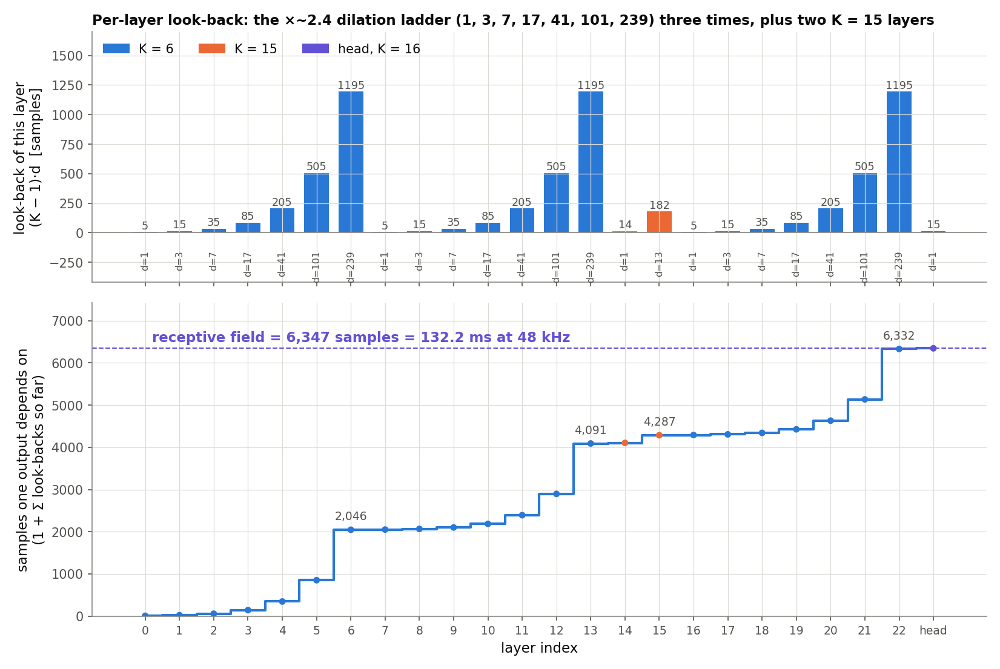

**The sum** (look-back = (K−1)·d per layer):

```
one ladder:      5·(1 + 3 + 7 + 17 + 41 + 101 + 239) = 5·409 = 2,045
three ladders:   3 · 2,045                                    = 6,135
K = 15 layers:   14·1 + 14·13 = 14 + 182                      =   196
all 23 layers:                                                  6,331
head conv:       (16 − 1)·1                                    =    15
the current sample itself:                                          1
receptive field: 1 + 6,331 + 15                                = 6,347 samples
```

6,347 / 48,000 = **132.2 ms**. The C++ computes the same number as its prewarm length
(`A2FastModel` constructor: `prewarm = 1 + Σ max_lookback + kHeadKernelSize − 1`; the generic
`WaveNet` matches it in `model.cpp`). **Prewarm** means feeding 6,347 samples of silence at load, so
every history buffer holds the network's response to silence instead of zeros.

**What 132 ms buys musically (Interpretation, then what I actually measured).** A real amp has slow
behavior: power-supply **sag** (the supply voltage droops under a loud chord and recovers over tens of
ms), compression, and envelope-dependent tone. A cabinet and microphone add resonances that ring for
milliseconds. A model with a 1 ms memory couldn't represent any of that; 132 ms can. Section 8 shows
what this capture actually uses, and it's less than you might think: the small-signal response puts
99.9% of its energy in the first ~23 ms.

---

## 5. The head

After layer 22, the head sum s (C × N) holds Σ over 23 layers of each layer's activation. The head is
one more causal convolution, **K = 16, d = 1, C → 1**, with a bias, followed by a fixed scale:

```
y(t) = head_scale · ( h_b + Σ_{k=0}^{15} Σ_{j=0}^{C−1} h[j, k] · s_j(t − (15 − k)) )
```

- **16 taps** = the last 16 frames of s: 15 samples (0.31 ms) of extra look-back, the "+15" in the sum above.
- **head_scale** = 0.011273. **Interpretation:** it brings the head sum's scale down to audio levels.
  On real audio (Full, section 8) the head sum ranges 0.62 … 25.0 with mean 8.41, all positive,
  while the output averages 0.0004 and peaks at 0.40. So the head's weights and bias also cancel a
  large positive offset.
- Head bias h_b: −0.0638 (Lite), 0.0431 (Full).
- `head1x1` is inactive in this file, so there's no extra 1×1 before the head.

**Code.** `_head_forward` in `a2_fast.cpp` writes s into its own ring buffer (16 − 1 = 15 columns of
look-back), then computes each output as a triple loop over frames, taps and channels. This project's
`a2_head_neon.patch` notes that a frame's 16 taps are 16 *consecutive* history columns (d = 1, and they
stay contiguous in both ring modes), so the whole head is one dot product of length 16·C (48 for Lite,
128 for Full) per frame. That's computed with two NEON accumulators (iteration 14: −1.4% Lite, −1.1%
Full).

---

## 6. Lite vs Full

Same topology, same dilations, same receptive field; only the width C differs (3 vs 8).

**Why cost scales with ~C².** Every layer's conv is K matrices of size C × C, and the 1×1 is one more.
Those terms are C², and they dominate. The mixin, rechannel and head are linear in C.

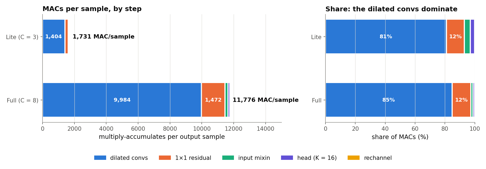

| Step (MACs per output sample) | Formula | Lite (C = 3) | Full (C = 8) |
|---|---|---|---|
| Dilated convs | Σ K·C² over 23 layers (Σ K = 21·6 + 2·15 = 156) | 1,404 | 9,984 |
| 1×1 residual | 23·C² | 207 | 1,472 |
| Input mixin | 23·C | 69 | 184 |
| Head | 16·C | 48 | 128 |
| Rechannel | C | 3 | 8 |
| **Total** | | **1,731** | **11,776** |

The C² terms are 93% (Lite) and 97% (Full) of the work, so the ratio is close to (8/3)² = 7.1. The exact
predicted ratio is 11,776 / 1,731 = 6.8×, and the Pi measured 6.9× (doc 02). Per layer, a K = 15 layer
costs 15/6 = 2.5× a K = 6 layer. That's why the two K = 15 layers (14, 15) matter when you balance a
pipeline (section 7).

**Slimmable training.** Atkinson's "Slimmable NAM" (arXiv 2511.07470) trains one network that can run
at several widths. To slim a layer from width c to c′, it truncates the weight matrices to their
leading c′ × c′ × k block. During training, each mini-batch uses a randomly chosen width
1 ≤ c′ ≤ c. The paper reports quality vs. compute as a Pareto plot; I didn't extract specific numbers.
**What this file shows:** the Lite weights are **not** literally the first 3 channels of the Full
weights. The script checks: Lite's rechannel ≠ Full's first three rechannel weights, and layer 0 tap 0
≠ Full's top-left 3 × 3 block. So the two submodels were exported as separate, self-contained
WaveNets. Whether they came from one slimmable run (as TONE3000 says) plus some export or fine-tuning
step, I can't tell from the file. This is also why NAM keeps both submodels in memory.

---

## 7. How the code runs it

### Block processing and the sequential chain

`A2FastModel::process()` (`a2_fast.cpp`) does, per block of N frames:

1. Rechannel: `layer_in[c, f] = rechannel_w[c] · input[f]`, and copy the input to a float `cond`
   buffer (the mixin uses it in every layer).
2. Zero `head_sum` (C × N).
3. For li = 0 … 22: `_layer_forward(li)`, which first copies this block's `layer_in` into the layer's
   **history ring buffer** (`_ring_write`), then runs `_layer_forward_k<K>`. That updates `layer_in`
   **in place** (the residual add) and accumulates into `head_sum`.
4. `_head_forward`: ring-write `head_sum`, run the K = 16 conv, scale, write the output.

**Why layers can't run in parallel with each other (for the same frames).** Layer i+1's input *is*
layer i's output, so layer i+1 can't start on frame f until layer i has produced frame f, and the
frames before it back to its look-back. That's a 23-deep dependency chain per frame. Within one layer,
though, all N frames and all C output channels are independent once the inputs exist. That's where the
parallelism is: SIMD lanes, register tiles, or threads over frames.

### Per-layer history: the ring buffers

To compute frame f, a layer needs its *input* at f − (K−1)·d. For the first frames of a block, that's
from previous blocks. So each layer keeps a **history buffer** of its own input: C rows × (look-back
+ N) columns at least. The head keeps one too (look-back 15).

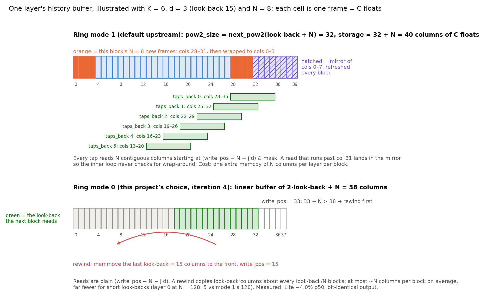

- **Ring mode 1** (upstream default, `NAM_A2_RING_MODE 1`). The buffer is `pow2_size` columns, where
  `pow2_size = next_pow2(look-back + N)`, plus N extra columns that **mirror** columns 0…N−1. A position
  wraps with `& mask`. Because the first N columns are copied to the end after every write (the
  **mirror**), any read of N consecutive columns is contiguous in memory even if it crosses the wrap
  point, so the inner loops never test for wrap-around. Cost: an extra `memcpy` of N columns per layer
  per block.
- **Ring mode 0** (`-DNAM_A2_RING_MODE=0`, this project's choice since iteration 4). A linear buffer of
  2·look-back + N columns. Writes advance `write_pos`; when the next block wouldn't fit, `memmove` the
  last look-back columns to the front (a **rewind**). Reads are plain `base − taps_back·d`. Measured:
  Lite −4.0% p50, max −18%, output **bit-identical** (iteration 4). The frame-split patch requires mode
  0.

**Memory** (history buffers only, floats, N = 128; printed by the script):

| | Ring mode 1 | Ring mode 0 |
|---|---|---|
| Lite (C = 3) | 210.0 KiB | 184.7 KiB |
| Full (C = 8) | 560.0 KiB | 492.6 KiB |

Per layer it ranges from 138 columns (layer 0 in mode 0) to 2,518 (each d = 239 layer in mode 0) or
2,048 + 128 (mode 1). Lite's histories (185 KiB in mode 0) fit easily in the Pi 2's shared 512 KB L2;
Full's (493 KiB) nearly fill it. That fits iteration 1's profile: >98.9% L1 hits, neither model memory-bound.

### The tap-major loop

Inside a layer the unpatched code is **tap-major**. For each tap k, it multiplies the tap's C × C
matrix by an N-frame slice of history and adds into the accumulator z (C × N); then the post-conv tail
runs. Every tap reads N contiguous history columns starting at `(write_pos − N − taps_back·d)`, which
the ring layout guarantees.

### How the project's optimizations map onto this picture

None of the patches changes the math (the network, its weights, its operation order per output).
They change **where intermediate values live and which core does which part**.

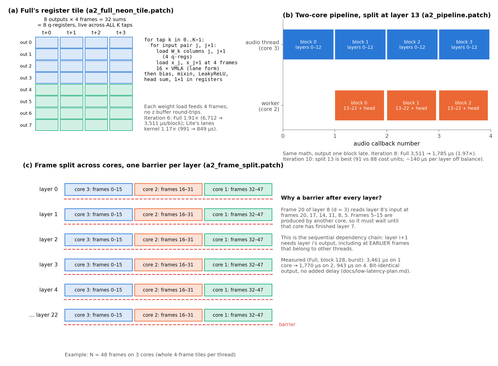

| Patch | What it changes in the picture | Measured | Accuracy |
|---|---|---|---|
| ring mode 0 (flag) | how history is stored (above) | Lite 1,032 → 991 µs p50 (iteration 4) | bit-identical |
| `a2_full_neon_tile.patch` | Full's tap loop: a tile of **8 output channels × 4 frames** = 32 sums held in 8 NEON q-registers across **all K taps**, then bias, mixin, LeakyReLU, head sum and 1×1 fused, so z never goes back to memory. Each weight load feeds 4 frames. | Full 6,712 → 3,511 µs (**1.91×**, iteration 6) | −132.8 dB (summation order) |
| `a2_lite_neon_lanes.patch` | Lite's tap loop: the 3 output channels in NEON lanes (padded to 4), 4-frame tiles, all taps fused, no `vld3` | Lite 991 → 849 µs (**1.17×**, iteration 6) | bit-identical |
| `a2_pipeline.patch` | Cuts the 23-layer chain in two **across blocks**: stage A (rechannel + layers 0–12) on the audio thread for block n, while stage B (layers 13–22 + head) runs block n−1 on a second core. Output is one block late. | Full 3,511 → 1,785 µs (**1.97×**, iteration 8); split 13 optimal (iteration 10) | bit-identical after a 1-block shift |
| `a2_head_neon.patch` | The head as one 16·C dot product per frame | −1.4% Lite, −1.1% Full (iteration 14) | −135.7 / −129.9 dB |
| `a2_frame_split.patch` | Splits **each layer's frames** across 2–4 cores (whole 4-frame tiles), with a **barrier after every layer**, because a layer reads earlier frames that another core produced | Full at 128: 3,461 → 1,770 µs on 2 cores, 943 µs on 4; no added delay (low-latency plan §3.3) | bit-identical |

Why split at layer 13? The cost of a layer is ∝ K, and layers 14–15 have K = 15. Layers 0–12 against
13–22 + head comes out to 91 vs 88 cost units (iteration 8), and moving the split one layer either way
costs ~140 µs per block (iteration 10). Why does frame split need a barrier per layer? Panel (c): with
d = 3, frame 20 of layer 8 reads its input at frames 20, 17, …, 5, and frames 5–15 came from another
core.

Why didn't simple vectorization win? Iteration 7 measured that on the Cortex-A7 every FP form peaks at
~1 float lane-op per cycle. So NEON helps only by cutting *non-arithmetic* instructions (loads, index
math, spills). That's what the register tile does, and it's why the second core was the bigger lever
(docs 05 and 07).

---

## 8. What the network does on real audio

All of this section is **observation of this particular capture** (Fender Super Reverb + cab), computed
by the float64 forward pass. Segment: `audio/di.wav` 19.25–20.25 s, which has a quiet stretch, a pick
attack at ~19.52 s, and two hard hits near 19.64 s and 19.82 s. The forward pass starts 6,347 samples
earlier so every layer has real history.

### Depth by depth (Full)

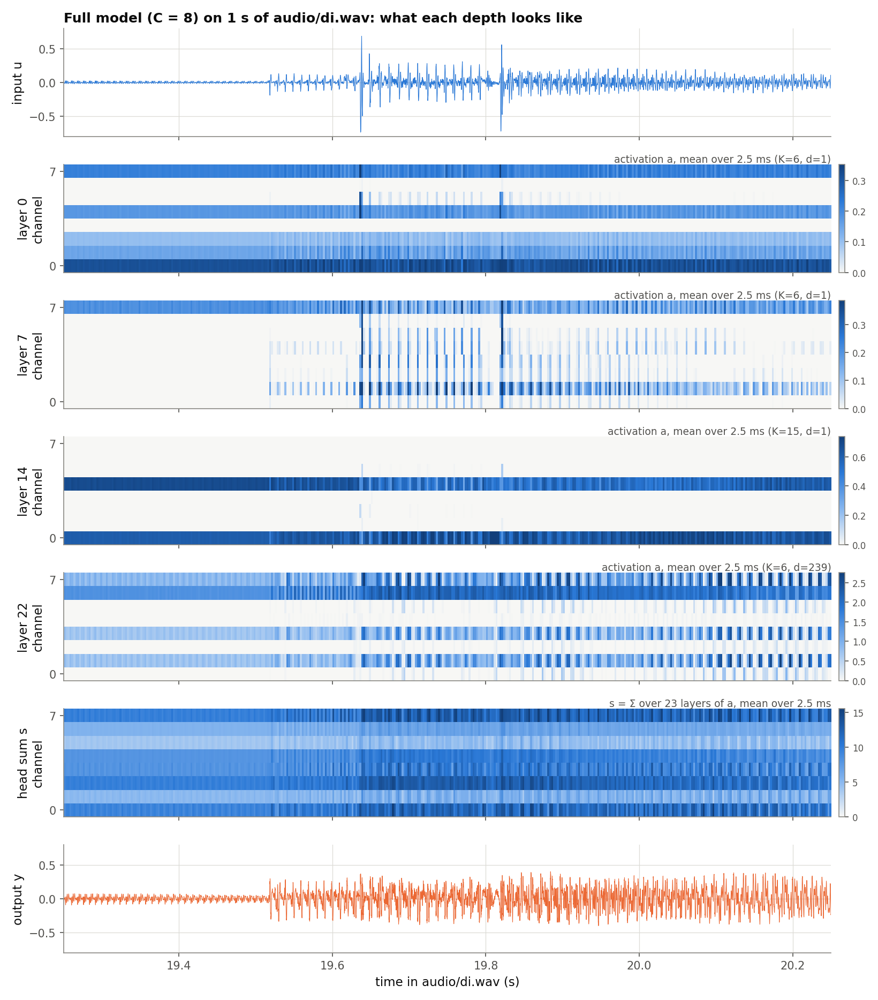

Each heatmap row is one channel's activation, averaged over 2.5 ms windows. White is ≈ 0, which
includes "negative" (LeakyReLU makes negatives at most a few hundredths here).

Over this second, the script classifies each channel per layer as *always on* (> 99% of samples
positive), *always off* (< 1% positive), or *switching*:

| Layer | 0 | 1 | 4–11 | 14 | 17 | 21 | 22 |
|---|---|---|---|---|---|---|---|
| on / off / switching (of 8) | 3 / 2 / 3 | 0 / 3 / 5 | 0 / 0 / 8 each | 1 / 5 / 2 | 5 / 0 / 3 | 6 / 1 / 1 | 1 / 0 / 7 |

What that means:

- An **always-on** channel never crosses zero, so over this passage it's purely linear (a filter).
- An **always-off** channel sits on the 0.01 slope; it passes 1% of a linear signal.
  **Interpretation:** it may be idle for this input level and wake up for louder or quieter playing.
- **Switching** channels are where the nonlinearity happens. In this second the middle of the stack
  (layers 4–11) switches in all 8 channels; the last layers are mostly on.
- Layer 0 (d = 1) follows the waveform closely. Layer 22 (d = 239, 1,195-sample look-back) shows
  slower, periodic patterns. That's consistent with deep layers summarizing longer stretches
  (Interpretation).
- The head sum is large and positive on every channel (0.62 … 25.0). The output is centered (mean
  0.0004).

### 25 ms zoom (Lite, three channels as traces)

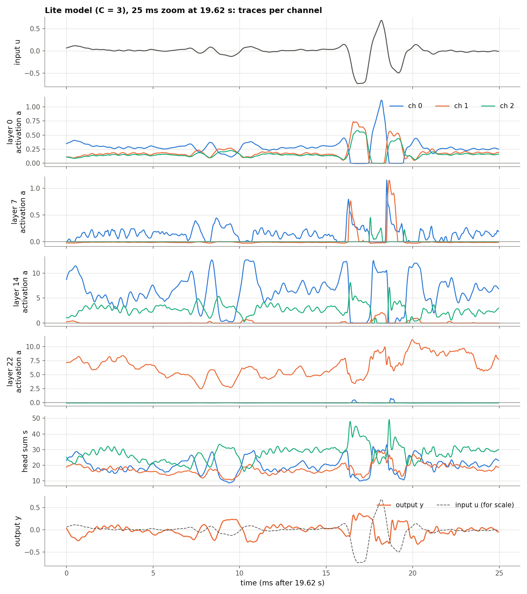

Around the hard hit at ~19.637 s (16–19 ms into the zoom), layer 0's channels clip one after another
as the input swings: channel 0 drops to ~0 while the input is very negative, and channels 1 and 2
drop out during the positive peak. Deeper activations grow (layer 14 reaches ~13, layer 22 ~11). One
channel can dominate a layer: in layer 22, channel 1 carries nearly everything. The output is not a
scaled copy of the input. Its large swing is flattened, and it's delayed (see the impulse response
below).

### Level in vs level out

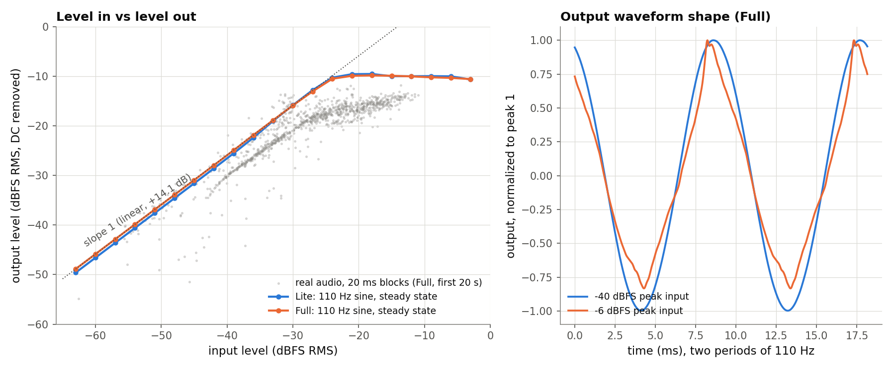

Steady-state 110 Hz sines at 3 dB steps (the script prints the table):

- **Quiet inputs are linear** with about **+14 dB** of gain (Full: −63.0 dBFS RMS in → −48.9 out;
  Lite → −49.6).
- **Above about −24 dBFS RMS input, the output stops growing**, near **−10 dBFS RMS** (Full −9.8 to
  −10.6 for every input from −21 to −3 dBFS RMS). That's hard compression/saturation: 18 dB more input
  gives slightly *less* output.
- The right panel shows the shape. At −40 dBFS peak the output is a clean sine; at −6 dBFS the peaks
  are flattened and asymmetric.
- Lite and Full track each other within ~1 dB on this test.
- Real-audio 20 ms blocks (gray) follow the same knee but sit lower at high levels.
  **Interpretation:** guitar notes aren't steady sines (attacks, decay, several harmonics), and the
  model's gain depends on frequency.

### What the 132 ms is used for (small signal)

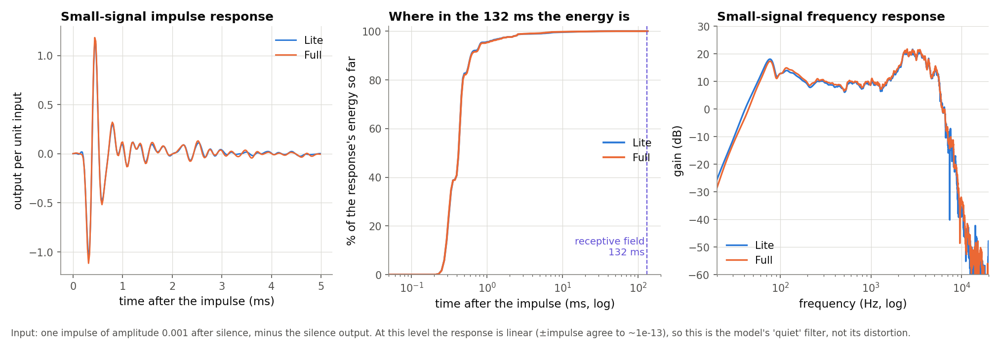

A single impulse of 0.001 after silence, minus the silence output, gives the model's
**small-signal impulse response**. At this level it is linear: +impulse and −impulse agree to ~1e-13.

- The response **peaks 21 samples (0.44 ms) after the input**. **Interpretation:** a microphone a
  short distance from the speaker (sound travels ~15 cm in 0.44 ms).
- **99% of its energy arrives within 3.6 ms (Full) / 5.1 ms (Lite), 99.9% within ~22–23 ms.** The
  tail is nonzero until ~5,800–6,100 samples, near the end of the receptive field, but tiny.
- Frequency response: +17 to +18 dB around 80 Hz, a broad +20 to +21 dB region around 3 kHz, then a
  steep drop (−12 to −19 dB at 8 kHz, −47 dB at 12 kHz). **Interpretation:** that's the shape of a
  guitar speaker cabinet (`"gear_type": "amp_cab"`): low resonance, presence peak, no highs.

**So what does the long receptive field buy here?** At low level, most of the memory goes to the cab's
filter, which lives in the first ~25 ms. **I didn't measure** a slow sag or envelope effect, and this
capture may or may not have much of one. Testing that would take tone bursts at several levels,
looking at the gain over the 100 ms after a loud onset; the script doesn't do that yet. Treat "the
132 ms models sag" as a design rationale, not something shown for this file.

---

## Key takeaways

> - Per sample: rechannel (C), then 23 × [K-tap dilated C×C conv + bias + dry-input mixin → LeakyReLU →
>   add to head sum; 1×1 + residual], then a 16-tap C→1 head × 0.011273.
> - Look-backs add: 3 × 2,045 + 196 + 15 + 1 = 6,347 samples = 132.2 ms. Dilations ×~2.4 with K = 6
>   leave no holes.
> - Cost ∝ C²: 1,731 vs 11,776 MAC/sample, 81–85% of it in the dilated convs.
> - Layers form a strict chain; parallelism lives inside a layer (lanes, register tiles, frames) or
>   across blocks (pipeline). Every optimization here changed execution, not math.
> - On this capture: linear +14 dB when quiet, saturating near −10 dBFS RMS; at low level the response
>   is a cab-like filter with 99.9% of its energy in the first ~23 ms.

## Glossary

- **Sample / frame:** one number per channel per 1/48,000 s. Mono, so a frame is one sample.
- **Block (N):** the frames processed per call (128 in most runs).
- **Causal:** output depends only on present and past input.
- **Receptive field:** how many input samples one output depends on (6,347).
- **Look-back:** one layer's reach into the past, (K−1)·d.
- **Kernel size (K):** taps per convolution (6, 15; head 16).
- **Dilation (d):** spacing between taps, in samples.
- **Channels / width (C):** values per frame inside the network (Lite 3, Full 8).
- **Bottleneck:** width of the conv output inside a layer; equals C in this file.
- **Rechannel:** the 1 → C input projection (no bias).
- **Input mixin / conditioning:** the raw input added inside every layer.
- **LeakyReLU:** z if z ≥ 0, else 0.01·z.
- **Residual connection:** adding a layer's update to its input (x_next = x + …).
- **1×1 convolution:** one-tap convolution = a C × C matrix per frame.
- **Skip path / head sum:** the running Σ of every layer's activation, read by the head.
- **Head:** the final K = 16, C → 1 convolution, bias and `head_scale`.
- **MAC:** multiply-accumulate, a ← a + w·x.
- **Prewarm:** feeding silence for one receptive field at load so histories are settled.
- **Ring buffer / mirror / rewind:** the per-layer history storage schemes (mode 1 / mode 0).
- **Register tile:** a block of outputs (8 channels × 4 frames) kept in CPU registers across all taps.
- **Slimmable:** one trained network usable at several widths.
- **Null test:** subtracting two renders; −130 dB means they agree to about 1 part in 3 million.

## Check yourself

**1. What are the shapes of x, s and y for Full at N = 128?**
x and s are 8 × 128; y is 1 × 128. u is 1 × 128.

**2. Write z_i(t) for one layer.**
z_i(t) = b_i + Σ_k Σ_j W_k[i, j]·x_j(t − (K−1−k)·d) + m_i·u(t); then a = LeakyReLU(z).

**3. Where does the raw input enter the network?**
Twice: through the rechannel (as layer 0's x) and through the mixin inside all 23 layers.

**4. What goes into the head sum: the layer's activation or its 1×1 output?**
The activation a (after LeakyReLU). The 1×1 output only feeds the residual stream.

**5. Derive 6,347.**
3 ladders × 5·409 = 6,135; K = 15 layers 14 + 182 = 196; head 15; plus the current sample: 1 + 6,331 +
15 = 6,347 (132.2 ms).

**6. Why don't dilations 1, 3, 7, …, 239 with K = 6 leave gaps in time?**
Each layer's tap spacing is smaller than the span the earlier layers already cover (≤ 5·Σ previous d +
1), so every lag 0…2,045 is reachable in one ladder (the script checks all 2,046).

**7. Why is Full ~6.8× the work of Lite, not 8/3 = 2.7×?**
The convs and 1×1s are C × C matrices: cost ∝ C². They're 93–97% of the MACs.

**8. Which number in the weight stream is head_scale, and why does it matter?**
The last one. The C++ uses it (not the JSON field); they differ only in float32 rounding.

**9. Why can't you run layer 5 and layer 6 at the same time on the same frames?**
Layer 6's input is layer 5's output, including at earlier frames (its look-back). The pipeline
sidesteps this by running them on different blocks; frame split runs one layer on several cores with
a barrier between layers.

**10. What does ring mode 1's mirror buy, and what does mode 0 do instead?**
Mirror: reads that cross the wrap point stay contiguous, with no wrap checks, for one extra N-column
copy per block. Mode 0: a linear buffer with an occasional `memmove` rewind; on average it copies less,
and it measured 4% faster for Lite with identical output.

**11. What did the register tile change: the math or the execution?**
Execution. Same products, kept in registers across taps; only summation order changed (−132.8 dB).

**12. On this capture, what happens above ~−24 dBFS RMS input, and how much of the 132 ms does the
quiet response use?**
The output saturates near −10 dBFS RMS. 99.9% of the small-signal impulse response's energy arrives in
the first ~23 ms.

## Reading list

- WaveNet (van den Oord et al., 2016): https://arxiv.org/abs/1609.03499. Section 2.1 (dilated causal
  convs), 2.3 (residual and skip connections), 2.4 (conditioning).
- Wright, Damskägg, Juvela, Välimäki, "Real-Time Guitar Amplifier Emulation with Deep Learning"
  (2020): [PDF](https://acris.aalto.fi/ws/portalfiles/portal/41964332/Real_time_guitar_amplifier_emulation.pdf)
- Atkinson, "Slimmable NAM": https://arxiv.org/html/2511.07470v1
- Code: `external/NeuralAmpModelerCore/NAM/wavenet/a2_fast.cpp` (`_load_weights`, `SetMaxBufferSize`,
  `_ring_write`, `_layer_forward_k`, `_head_forward`, `process`), the generic path in
  `NAM/wavenet/model.cpp` (`Layer::Process`, `LayerArray::ProcessInner`), and the patches in
  `patches/`.
- Figures and numbers: `scripts/make_wavenet_figures.py`; forward pass: `scripts/quant_sim.py`.
